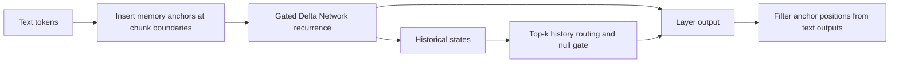

# MARCH architecture

Safin-1 retains Qwen3.5's dense or MoE backbone and full-attention layers.
MARCH extends its linear-attention Gated Delta Network with learned boundary
tokens, called **memory anchors**, and HSD historical-state read/routing.

The standard profiles insert one anchor per 512 text tokens. Layout utilities
track anchor masks and text positions so generation can cross chunk boundaries.
Historical-state read uses top-k 4, global-read layers 10–30 and a 32768-token
read block in both verified checkpoint profiles. An existing checkpoint's saved
runtime takes precedence over new-training templates.

`march/safin1/` provides dense/MoE HF remote code and shared layout/cache/GDN
helpers. `march/training/` prepares packed batches; `march/inference/` owns
paged history and varlen producers. `march/kernels/` supplies shared autograd kernels. The
vendored bridge implements Megatron construction and Safin-1 export; vendored
vLLM implements prefill, paged history and Graph decode.

HF is the reference execution path. vLLM's Graph profile accelerates eligible
decode steps while keeping eager/segments fallback for anchor boundaries and
unsupported layouts.

Persistent state is optional learned model state and is disabled in the standard
profiles. It is distinct from a request's runtime recurrent/cache state. See
[persistent state](persistent-state.md) before enabling it.

The namespace `hsd_*` is intentional. Memory-anchor controls use `anchor_*` or
`hsd_anchor_*`. The [naming guide](naming.md) maps model types, Python entrypoints
and the migration of older checkpoint schemas.
